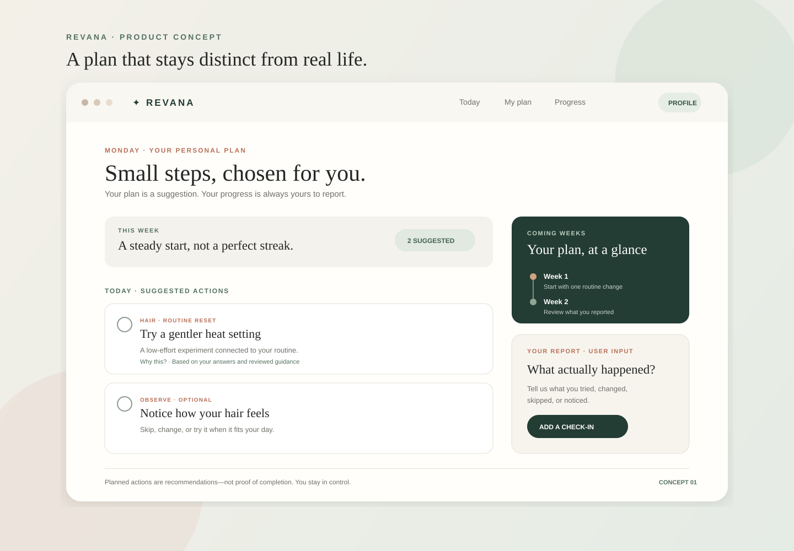
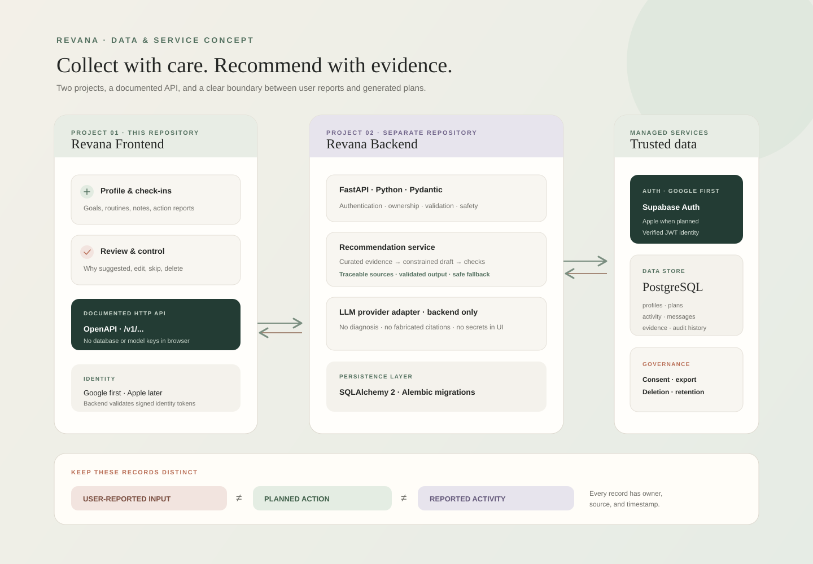

# Revana Product and Technical Roadmap

## Product direction

Revana helps a person turn their own goals and context into a small, adaptable plan, then understand what they actually tried and how it felt. Improve the frontend gradually; build a trustworthy data and service foundation before adding complex analytics or automation.

The product timeline has three distinct records:

1. **Today:** actions suggested by the current plan.
2. **Coming weeks:** future planned actions, grouped by week and versioned.
3. **What happened:** actions the user reports completing, skipping, changing, or reflecting on.

A planned action is never evidence that the user completed it. Keep plans and user-reported activity separate in storage, APIs, copy, and visualizations.

## Repository and service boundaries

Maintain two independently developed and deployed projects:

- **Frontend (this repository):** React, TypeScript, Vite, and Tailwind CSS. Owns the experience, client-side input handling, and API client. It must not access the database or hold model/provider secrets.
- **Backend (a separate repository/project to create):** Python, FastAPI, PostgreSQL, authentication-token verification, data access, research retrieval, recommendation orchestration, and versioned HTTP APIs.

Document the API contract with OpenAPI. The frontend consumes only the backend API. Keep environment-specific URLs and public client configuration in frontend environment variables; keep database credentials, OAuth secrets, and LLM credentials on the backend or their trusted provider.

## Suggested initial technology stack

| Area | Recommendation | Reason / guardrail |
|---|---|---|
| Frontend | Existing React 19 + TypeScript + Vite + Tailwind CSS v4 | Preserve the working prototype and evolve it incrementally. |
| Backend | Python 3.12+ + FastAPI + Pydantic | Typed request/response validation and generated OpenAPI documentation. |
| Database | Managed PostgreSQL, initially Supabase PostgreSQL | Relational ownership and history suit profiles, plans, actions, conversations, and evidence. Use migrations; do not make provider-specific client queries from the frontend. |
| Authentication | Supabase Auth; Google OAuth first, Apple as a later provider | Keeps identity separate from app-domain data while providing standard JWTs. Backend verifies tokens and derives the user ID from the verified identity, never from a trusted request-body field. |
| Persistence layer | SQLAlchemy 2 + Alembic migrations | Explicit schema and controlled database evolution. |
| API | REST with versioned paths (`/v1/...`) and OpenAPI | Simple browser integration and a stable contract between separate repositories. |
| LLM integration | Backend-only provider adapter with structured output validation | Allows provider changes, safe key handling, timeouts, observability, and deterministic fallback behavior. |
| Research | Curated source registry and reviewed recommendation rules first; PostgreSQL full-text search initially | Keep each recommendation traceable to reviewed sources. Add vector retrieval only when a demonstrated retrieval need exists. |
| Hosting | Choose managed services after a small deployment spike | Confirm region, backups, OAuth callback support, data-processing terms, pricing, and operational ownership before selecting production vendors. |

Supabase is a starting recommendation, not a requirement. Before production, confirm data residency, backup/restore, access-control, retention, and regulatory needs. Consider a separately operated PostgreSQL service if those requirements or operational constraints call for it.

Google-first is suitable for the first web release. Add Apple sign-in when the iOS/native product is planned or user demand justifies it; confirm current Apple platform and store-review requirements before shipping. Keep email recovery and account deletion in scope even if social sign-in is the first path.

## Core domain model

Use UUID primary keys, UTC timestamps, explicit ownership, and database migrations. Store the user's IANA timezone for local-day and weekly grouping. Validate enums and lengths in the API and database. Prefer archive/deletion policies that are explicit and user-accessible.

### User and profile

- `users`: internal user ID, identity-provider subject, created/updated timestamps, account status.
- `profiles`: user ID, display name (optional), timezone, locale, preferences, onboarding completion state.
- `profile_facts`: user ID, category, value or structured JSON, source (`user_reported` or `derived`), confirmed-at, created/updated timestamps.
- `consents`: user ID, consent type, policy/version, granted/revoked timestamps.

Goals, concerns, routines, sensitivities, budget, and effort preferences are profile facts or typed profile fields. Clearly distinguish user-entered facts from derived/inferred values; derived values must include their basis and must not silently overwrite user input.

### Plans and timeline

- `plans`: user ID, version, status (`draft`, `active`, `superseded`, `archived`), start/end dates, generation metadata, created-at.
- `planned_actions`: plan ID, stable action ID, title, instructions, cadence, scheduled dates, rationale, evidence references, confidence/limitations, safety flags.
- `activity_events`: user ID, optional planned-action ID, event type (`completed`, `skipped`, `modified`, `observation`), occurred-at, optional note, optional structured outcome, created-at.

The same activity event model should support an action done outside the plan by allowing a null planned-action ID. Record edits as events or preserve an audit history; do not silently erase user history.

### Conversations and evidence

- `conversations`: user ID, optional plan ID, title, created/updated timestamps.
- `messages`: conversation ID, role, content, created-at, optional related action; preserve whether content was user-entered or model-generated.
- `evidence_sources`: citation, publisher, publication date, URL/identifier, review date, status.
- `recommendation_evidence`: planned-action ID, evidence-source ID, claim/relationship, retrieval metadata.
- `generation_runs`: plan ID, model/provider and prompt version, input snapshot/reference, validation status, safety-review outcome, failure/fallback reason. Avoid retaining unnecessary sensitive prompts or raw model traces.

Conversations and profile data may be sensitive. Apply least privilege, user-scoped authorization, retention limits, export/deletion flows, and explicit consent. Do not collect health or appearance data without a clear product need and transparent explanation.

## API boundary (initial proposal)

- `GET /v1/me` — current authenticated profile summary.
- `PUT /v1/me/profile` — create/update user-provided profile information.
- `GET /v1/plans/current` — current plan and planned actions.
- `POST /v1/plans` — request a plan draft; backend persists a version and returns validation/safety status.
- `POST /v1/activity-events` — record a completion, skip, modification, or observation.
- `GET /v1/activity-events` — fetch a paginated timeline, filterable by date and action.
- `GET|POST /v1/conversations` and `POST /v1/conversations/{id}/messages` — user-owned conversation history.
- `GET /v1/account/export` and `DELETE /v1/account` — user data portability and deletion workflows.

Use pagination for history, idempotency for retryable writes, consistent error shapes, and authorization checks on every user-owned resource. Derive ownership from the verified token, not a caller-supplied user ID.

## Recommendation and research rules

1. Begin with a reviewed, versioned set of recommendations and an evidence registry.
2. Retrieve only sources that match the user's goal and context; record the sources, review date, and claim used.
3. Ask the backend LLM adapter for a schema-constrained draft, not an unstructured prescription.
4. Validate the draft against the schema, allowed action catalog, safety constraints, and evidence policy before saving or showing it.
5. If generation fails or evidence is insufficient, return a clear deterministic fallback or ask for clarification; never fabricate citations or hide failure.
6. Explain why an action is suggested, what is uncertain, and how the user can decline or adapt it.
7. Treat symptom escalation and medical questions conservatively; the product does not diagnose or replace qualified care.

## Phased delivery plan

### Phase 0 — Product and contract foundation

- Confirm target platform, data categories, consent, retention, and account deletion expectations.
- Finalize the data model and OpenAPI conventions; create the separate backend repository.
- Agree on a versioned API contract and shared examples before wiring live requests.
- Keep current frontend defaults as clearly labeled prototype fallback data.

### Phase 1 — Backend foundation

- Set up FastAPI, PostgreSQL, SQLAlchemy, Alembic, configuration/secrets management, CI, and health checks.
- Implement token verification and a user-scoped `/v1/me` endpoint.
- Add schema validation, structured error responses, request IDs, and authorization tests.

### Phase 2 — Profile and user-reported activity

- Persist onboarding/profile data and support user edits.
- Store completed, skipped, modified, and observed actions as distinct activity events.
- Add export/deletion behavior and basic retention policy before production data collection.

### Phase 3 — Plans and timeline

- Persist versioned weekly plans and planned actions separately from activity events.
- Build the frontend timeline progressively: today, coming weeks, and reported history.
- Add empty, loading, error, and offline states; let users revise or reject actions.

### Phase 4 — Evidence-backed recommendations

- Curate sources and rules first; connect the backend LLM only behind a validated service boundary.
- Track generation versions, evidence links, validation results, and fallbacks.
- Evaluate usefulness, safety, unsupported claims, demographic coverage, and failure behavior before wider rollout.

### Phase 5 — Conversations, authentication expansion, and insight

- Add persisted conversations with clear AI labeling and user control over retention.
- Launch Google OAuth first; add Apple sign-in after platform and account-linking requirements are confirmed.
- Add trend visualizations only when sufficient user-reported events exist; show date ranges, missing data, and uncertainty.

## Product decisions still to resolve

- Initial launch platform (web only vs. planned iOS app) and account-linking behavior.
- Which profile facts are necessary for the first useful plan, and which should not be collected.
- Data retention periods, export format, deletion behavior, and backup deletion expectations.
- Hosting region and provider terms for database, auth, and model processing.
- Whether conversations are retained, summarized, or user-deletable individually.
- Evidence-review owner and cadence; sources allowed for recommendations.
- Which outcomes can be measured safely without claiming causation.
- Expected scale, budget, uptime, and support/incident ownership.

## Product and data-flow visuals

### App experience: plan versus reported progress

### Data collection and service boundaries

